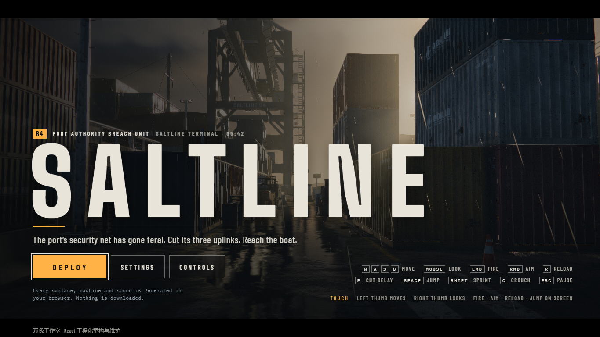
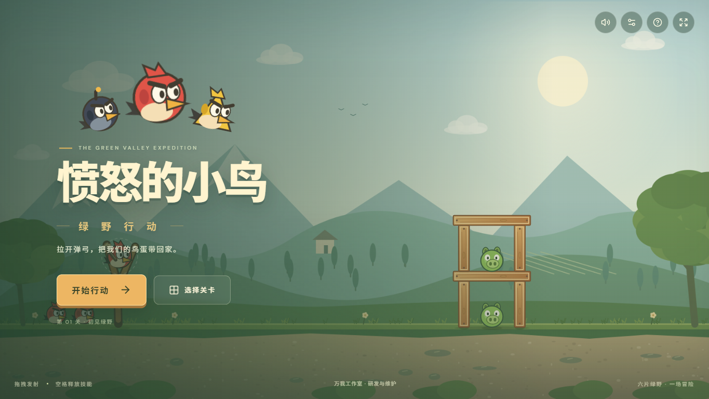
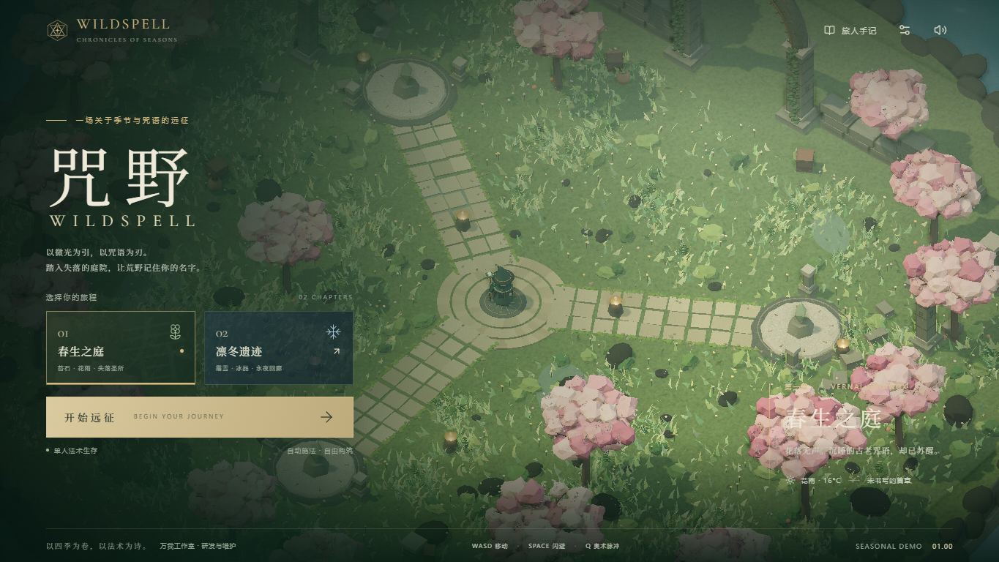

# 万我工作室 · 游戏研究与实践

本仓库收录三个独立的浏览器游戏 Demo，用于技术研究与学习实践，涉及 React 应用组织、程序化场景与音效、物理交互和游戏工程化维护。万我工作室负责各版本的研发或 React 工程化重构及持续维护，具体范围见各项目的研发声明。

**[进入试玩首页](https://ztaer.github.io/ai-game-analysis__saltline/)**，选择游戏即可开始，无需安装开发环境。

## 三个游戏

### Saltline · React 可维护版

原 `saltline-fable-5.2` 第一人称射击游戏的 React 工程化重构，目标是保留原版玩法、数值、画面与交互。玩家需要切断三个中继并抵达船只；React 管理应用与菜单，Three.js 游戏模块负责场景、玩家、武器、敌人及音频，配置与启动流程按职责拆分，附有中文维护文档。

[](https://ztaer.github.io/ai-game-analysis__saltline/saltline/)

[在线试玩](https://ztaer.github.io/ai-game-analysis__saltline/saltline/) · [项目说明与源码入口](saltline-fable-5.2-react/README.md) · [研发声明](saltline-fable-5.2-react/研发声明.md) · [维护指南](saltline-fable-5.2-react/docs/MAINTENANCE.md)

### 愤怒的小鸟 · 绿野行动

React + TypeScript 开发的二维弹弓物理游戏，使用 Matter.js 模拟碰撞与结构破坏。包含六个关卡、三种小鸟能力、星级评分与本地进度；场景和角色由 Canvas 绘制，音效由 Web Audio 合成，支持鼠标、键盘和触屏操作。

[](https://ztaer.github.io/ai-game-analysis__saltline/birds/)

[在线试玩](https://ztaer.github.io/ai-game-analysis__saltline/birds/) · [项目说明与源码入口](saltline_愤怒的小鸟/README.md) · [研发声明](saltline_愤怒的小鸟/研发声明.md)

### 咒野 · WILDSPELL

React + Three.js 开发的俯视角法术生存肉鸽 Demo。春生之庭与凛冬遗迹两个篇章包含探索、自动施法、升级构筑、祭坛与 Boss 战；Rapier 处理角色和场景物理，支持键鼠与触控操作。

[](https://ztaer.github.io/ai-game-analysis__saltline/wildspell/)

[在线试玩](https://ztaer.github.io/ai-game-analysis__saltline/wildspell/) · [项目说明与源码入口](saltline_咒语乐团/README.md) · [研发声明](saltline_咒语乐团/研发声明.md)

## 项目结构与本地开发

三个游戏分别拥有自己的源码、依赖、开发命令和构建产物，当前没有合并为一个应用或工作区。通常从试玩首页选择游戏即可；需要阅读代码或修改功能时，再进入对应目录。

```text
.
├─ site/                         试玩首页与游戏截图
├─ saltline_愤怒的小鸟/           绿野行动：独立 React + TypeScript 项目
├─ saltline_咒语乐团/             咒野：独立 React + Three.js 项目
├─ saltline-fable-5.2-react/       Saltline：React 工程化重构版
├─ saltline-fable-5.2/            原始版本，仅作为阅读与对照测试基准
└─ .github/workflows/pages.yml    GitHub Pages 构建与发布工作流
```

请按各项目现有锁文件安装依赖，并在对应项目目录执行命令：

| 项目 | 包管理器与锁文件 | 安装 | 开发 | 构建 |
| --- | --- | --- | --- | --- |
| 绿野行动 | Yarn 4 / `yarn.lock` | `yarn install --immutable` | `yarn dev` | `yarn build` |
| 咒野 | npm / `package-lock.json` | `npm ci` | `npm run dev` | `npm run build` |
| Saltline React | Yarn 4 / `yarn.lock` | `yarn install --immutable` | `yarn dev` | `yarn build` |

具体环境要求、端口、操作说明和测试命令见各项目 README。部分目录保留了历史 npm 锁文件；发布流程按上表使用包管理器，不需要为了发布迁移所有项目的依赖配置。

## GitHub Pages 发布

发布由 [`.github/workflows/pages.yml`](.github/workflows/pages.yml) 管理。当推送到 `main` 的改动涉及游戏、试玩首页或发布配置时，工作流分别安装和构建三个项目，将 `site/` 作为首页，并把游戏产物放入对应子目录，统一发布到 GitHub Pages。也可以在 Actions 页面手动运行该工作流。

| 页面 | 在线入口 |
| --- | --- |
| 试玩首页 | [选择游戏](https://ztaer.github.io/ai-game-analysis__saltline/) |
| Saltline React | [saltline/](https://ztaer.github.io/ai-game-analysis__saltline/saltline/) |
| 绿野行动 | [birds/](https://ztaer.github.io/ai-game-analysis__saltline/birds/) |
| 咒野 | [wildspell/](https://ztaer.github.io/ai-game-analysis__saltline/wildspell/) |

上述链接为发布入口；发布是否完成以 GitHub Actions 工作流结果与实际页面访问为准。原始 `saltline-fable-5.2` 目录保留为对照基准，不作为第四个游戏发布。

## 来源与归属

绿野行动参考 Saltline 的程序化场景与合成音效思路，独立实现二维游戏；咒野的自动施法生存与法术组合玩法参考《咒语旅团》，场景氛围参考 Saltline，其角色、美术、法术、地图和音乐为独立的程序化实现。具体说明保留在各项目 README 与研发声明中。

Saltline React 基于原 Saltline 游戏重构。原仓库记载游戏由 **Claude Fable 5.2** 创建，生成过程由 **Felix Rieseberg（Anthropic）** 设置并分享；原作与镜像来源链接完整保留在 [Saltline React 的“来源与署名”](saltline-fable-5.2-react/README.md#来源与署名)。万我工作室的署名对应本版本的工程化重构与维护工作。

参考作品及其原有内容、第三方组件、相关名称与标识仍归各自权利人所有，各项目原有来源、署名与许可说明保留。本仓库不新增或推定原作品及第三方内容的授权许可。
