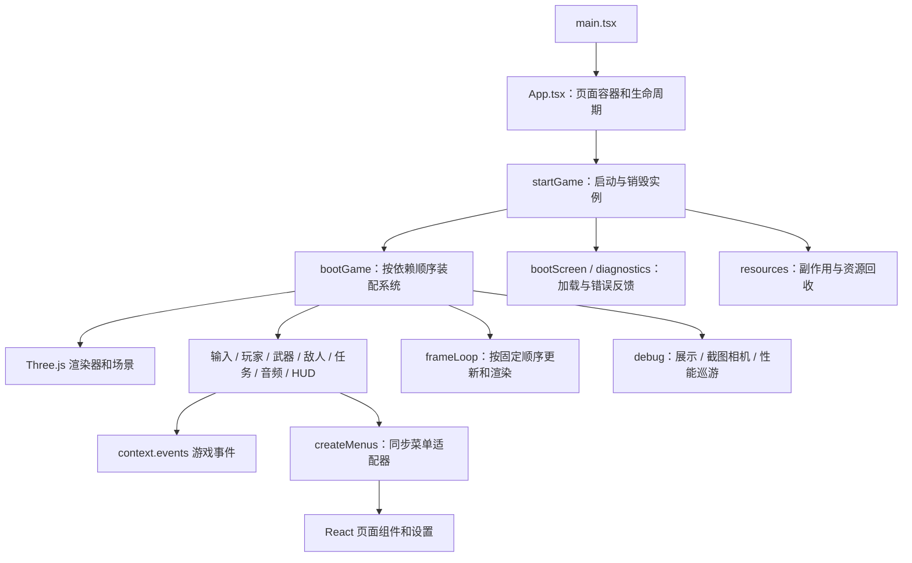

# 架构与源码导航

## React 与游戏引擎的边界

`main.tsx` 创建页面的 React 根，`App.tsx` 声明 `#app`、`#view`、`#ui` 和加载提示，挂载后调用 `startGame()`，卸载时调用其 `dispose()`。这条阅读入口保持不变；继续追踪初始化时，进入 `bootGame.ts`，追踪游戏运行时进入 `frameLoop.ts`。三维世界使用 Three.js 原生场景图；运行上下文 `context` 保存各子系统及共享时间、随机数、事件总线。

`createMenus(context, actions)` 在 `#ui` 内创建独立的 React 菜单根。菜单由 JSX 组件声明，状态通过 `useSyncExternalStore` 同步。游戏状态机仍可立即调用 `menus.show()`、`setDead()`、`setDebrief()`，通过同步适配保留原版的菜单显隐与焦点顺序。按钮委托监听保留在菜单宿主上，使音频恢复与鼠标捕获仍直接处于用户点击事件内。

准星、罗盘、弹药、世界坐标标记及伤害反馈属于高频 HUD，在 `hud.js` 中直接更新原 DOM。不要把逐帧镜头、模型矩阵或所有 HUD 数值同步进 React state；游戏与 React 仅在菜单和设置等状态变化时交互。

## TypeScript 类型边界

| 文件                                                           | 作用                                                               |
| -------------------------------------------------------------- | ------------------------------------------------------------------ |
| `src/game/types.ts`                                            | 游戏上下文、启动句柄、子系统最小公开接口、帧循环与截图参数         |
| `src/ui/types.ts`                                              | 菜单状态、设置字段、死亡/结算结果、设置变更回调                    |
| `src/env.d.ts`                                                 | Vite 资源类型、保留的调试变量与 WebKit 全屏接口                    |
| `input/input.d.ts`、`runtime/debug/*.d.ts`（位于 `src/game/`） | 为动态 JavaScript 工厂提供启动层需要的接口；执行文件仍为同名 `.js` |
| `tsconfig.json`                                                | 严格检查 TS/TSX，允许导入既有 JS，只检查不输出，由 Vite 打包       |

`GameContext` 描述启动和界面实际使用的接口，并不宣称全部 JavaScript 实现已完成类型检查。装配函数在 JS 工厂返回处完成边界断言；销毁接收 `BootContext`（部分上下文），因为初始化中途也可能被取消。新增跨层方法时同时更新接口、JS 实现及相应回归，不要把上下文改成可任意访问属性的 `any`。

阅读顺序仍是 `main.tsx → App.tsx → runtime/startGame.ts → runtime/bootGame.ts → runtime/frameLoop.ts`；遇到 `GameHandle`、`GameContext`、`MenuState` 等类型再跳到对应 `types.ts`。`import type` 只用于编辑器与编译检查，不创建游戏实例，也不进入浏览器运行依赖图。

## 启动与一帧执行

`runtime/startGame.ts` 只管理运行实例的生命周期：替换旧实例、建立资源收集器、启动异步装配、处理失败和清理资源。返回的 `ready` 在初始化并安装帧循环后结算，不等待玩家点击 Deploy，也不保证全部音效已生成；音效准备另有 `context.audio.ready`。`dispose()` 可在启动中或运行后调用，多次调用只清理一次。

`runtime/bootGame.ts` 是系统创建顺序的唯一入口：解析 URL → 选择画质 → 渲染器 → 材质 → 物理/道具/输入 → 关卡与远景/地面 → 构建碰撞数据 → 特效/音频 → 玩家/战斗 → 武器/敌人/HUD → 任务状态机 → 渲染首帧准备 → 安装动画循环。各工厂收到同一个逐步补齐的上下文；创建过程中只能访问已经装配的系统。

加载文字与进度由 `bootScreen.ts` 管理，错误记录和失败面板由 `diagnostics.ts` 管理。`runtime/debug/` 放展示注册表、固定截图相机和性能巡游；这些调试入口仍由原 URL 参数启用。

展示模式 `?show=...` 走原来的精简场景分支，并用专用占位子系统补齐接口。普通运行中部分可选子系统失败时使用 `core/fallbacks.js` 的原版降级接口，关键渲染器或关卡失败会显示错误提示。

`frameLoop.ts` 先更新输入和任务，再视任务状态更新玩家、武器与敌人；随后更新武器湿润度、环境、音频和 HUD，最后渲染并调用 `input.endFrame()` 清空本帧输入边沿状态。`pressed` 表示本帧新按下，`down` 表示持续按住，必须等所有消费者读完才清理前者。暂停时不推进玩家/武器/敌人和环境更新，仍同步音频、HUD 与渲染。

普通模拟步长 `dt` 以秒计，默认上限为 0.05 秒；URL 的 `dt` 可覆盖它以便回归。FPS 统计使用真实帧耗时。共享时间仍随帧循环推进，任务计时由状态机另行控制，不能用“暂停了”推断所有时钟都停止。更新顺序会影响后坐力、碰撞、敌人反应与 HUD，重排时需要行为和画面对照。

## 游戏模块导航

`src/game/` 按功能目录组织，目录内再区分配置、运行逻辑和资源生成。下表覆盖引擎入口和相关实现；源码路径均相对于该目录。

| 模块                                                          | 职责与阅读重点                                                              |
| ------------------------------------------------------------- | --------------------------------------------------------------------------- |
| `config.ts`                                                   | `WORLD_BOUNDS`、太阳/天空、`PLAYER_CONFIG`、`QUALITY_PRESETS`、设备画质选择 |
| `runtime/startGame.ts`                                        | `startGame()` 的 `ready`/`dispose` 契约、实例替换、启动取消与销毁           |
| `runtime/bootGame.ts`                                         | URL 参数、共享上下文、系统装配顺序、普通/展示启动分支                       |
| `runtime/frameLoop.ts`                                        | 模拟步长、暂停规则、子系统更新顺序、渲染和输入边沿清理                      |
| `runtime/bootScreen.ts`、`runtime/diagnostics.ts`             | 加载提示、错误收集、失败反馈及控制台恢复                                    |
| `runtime/debug/benchmark.js`、`shotCamera.js`、`showcases.js` | 性能巡游、固定相机、子系统展示注册及占位接口                                |
| `runtime/resources.ts`                                        | `beginResources`、`listen`、`defer`、音频上下文所有权与 `releaseGame`       |
| `core/events.ts`                                              | 游戏内事件总线，子系统通过事件解耦                                          |
| `core/math.ts`                                                | clamp、lerp、smoothstep、damp 等共享数学函数                                |
| `core/random.ts`                                              | 原版带种子的随机序列                                                        |
| `core/geometry.js`                                            | 合并几何、倒角、圆柱、管线及共享网格操作                                    |
| `core/fallbacks.js`                                           | 可选子系统失败时的接口占位实现                                              |
| `core/defineExports.js`                                       | 原展示注册表所用的惰性导出工具                                              |
| `render/renderer.js`                                          | Three.js 渲染器、天空/后处理、阴影、反射、画质切换、统计                    |
| `materials/materials.js`                                      | 程序化纹理、材质库、湿润度与材质着色器扩展                                  |
| `physics/physics.js`                                          | 场景碰撞、胶囊移动、射线、视线检测及导航                                    |
| `level/level.js`                                              | 关卡布局、出生点、中继、撤离点、巡逻/增援位置、标题镜头路径                 |
| `backdrop/backdrop.js`                                        | 远景港口、起重机等环境构建与更新                                            |
| `ground/ground.js`                                            | 地面、水面、积水、雨与相关视觉更新                                          |
| `effects/effects.js`                                          | 弹道、火花、烟尘、爆炸等瞬时特效                                            |
| `props/props.js`、`props/register.js`                         | 道具工厂入口与模块注册；启动时需完成注册                                    |
| `props/cargo.js`、`props/softCargo.js`                        | 集装箱/硬质货物、软质货物相关生成器                                         |
| `props/machinery.js`、`props/detailGeometry.js`               | 机械与细部模型生成                                                          |
| `input/input.js`                                              | 键鼠、指针锁定与回退、触摸、标准手柄映射、输入边沿                          |
| `player/tuning.ts`                                            | `PLAYER_TUNING`、派生跳跃初速度和玩家参数单位；调整移动/恢复/反馈数值的入口 |
| `player/player.js`                                            | `createPlayer`、移动/跳跃/蹲伏、伤害恢复、镜头反馈的运行逻辑                |
| `combat/combat.js`                                            | 命中判定、伤害、近战、战斗统计及关联事件                                    |
| `weapon/weapon.js`                                            | 武器运行态、射击/换弹/瞄准动画、弹药、湿润度、展示姿态                      |
| `weapon/tuning.ts`                                            | 弹匣/备弹、射速、基础伤害、射程、换弹时间及各持枪姿态                       |
| `weapon/rifleGeometry.js`、`weapon/hands.js`                  | PAC-9 几何结构、手部与袖口模型                                              |
| `weapon/materials.js`、`weapon/decals.js`、`weapon/optic.js`  | 枪械表面、铭文、镜片与瞄准点                                                |
| `enemies/enemies.js`                                          | `ENEMY_TUNING`、生成/清除、群体管理、弹体与调度                             |
| `enemies/gull.js`、`enemies/hound.js`                         | 飞行无人机和机械犬的各自行为                                                |
| `enemies/models.js`                                           | 敌人程序化模型、骨骼                                                        |
| `enemies/hitTests.js`                                         | 管理器与机械犬共享的射线/球体与胶囊相交测试，避免互相导入                   |
| `audio/audio.js`                                              | Web Audio 运行态、混音/空间化、事件订阅、暂停/恢复                          |
| `audio/soundBank.js`                                          | `SOUND_BANK`，声音名称、生成器、优先级、采样率、并发限制                    |
| `audio/sounds.js`、`audio/synthesis.js`                       | 音效配方与底层波形/滤波/噪声合成                                            |
| `audio/music.js`                                              | 音乐生成、结构和 `MUSIC_CONFIG`                                             |
| `hud/hud.js`                                                  | 罗盘、准星、目标、弹药、生命、击杀提示、无线电字幕、触摸交互提示            |
| `gameplay/missionConfig.ts`                                   | `GAME_CONFIG`、波次数量、交互范围/时间、任务节奏和罗盘方位                  |
| `gameplay/radioLines.ts`                                      | `RADIO_LINES`，按任务阶段分组的无线电台词                                   |
| `gameplay/gameFlow.js`                                        | 任务状态、中继进度、增援、撤离和评分的运行逻辑                              |

界面源码位于 `src/ui/`：`MenuScreens.tsx` 负责各页面，`SettingsPanel.tsx` 负责设置面板，`Controls.tsx` 负责操作说明，`settings.ts` 负责校验、持久化和应用设置，`createMenus.tsx` 负责与引擎衔接。

## 状态和事件

任务状态保留 `title → intro → playing`，游戏中可进入 `paused`、`dead` 或 `complete`。`game.run` 保存本轮时间、重试次数、中继进度和敌人增援队列。UI 不自行判定胜负；死亡、撤离和评分由任务状态机负责。

常见事件包括 `weapon:fire`、`player:hit`、`player:dead`、`enemy:killed`、`objective:progress`、`objective:done`、`objective:all`、`game:state`、`ui:click`、`ui:hover`。事件总线同步调用订阅者，不复制载荷；订阅者拿到的是同一份对象或向量引用。修改订阅者前先搜索生产者，保持字段和触发顺序一致。若需异步使用当时的位置，应在回调内显式复制，避免读到对象后续帧的新位置。

HUD 在自己的更新阶段读取玩家、武器和任务的当前状态，事件用于击杀提示、无线电和受击反馈等瞬时变化。调整状态写入位置时，要同时考虑本帧的后续消费者和下一帧行为。

## 配置与注释约定

只由一个功能使用的数值优先放在同功能目录，例如 `player/tuning.ts`、`weapon/tuning.ts`、`gameplay/missionConfig.ts`。通用 `config.ts` 保留世界边界、天空、玩家基础体型和画质等共享配置；不要把所有参数不断集中到一个全局文件。模型几何和大量程序化资源配方仍留在各自模块，避免拆成难以关联的零散文件。

关键工厂和方法的 JSDoc 说明输入、返回接口、单位及生命周期；局部中文注释说明更新顺序、共享引用、原地修改和不直观算法的原因。距离通常以世界米计，时间以秒计，旋转通常用弧度，FOV 使用度，射速使用发/分钟；以具体配置旁的单位为准。修改行为时同步维护注释，避免只增加逐行翻译。

## 生命周期约定

运行实例使用资源收集器记录浏览器监听、延迟任务和音频上下文。销毁时停止 Three.js 动画循环、退出指针锁定、卸载菜单 React 根、回收场景几何/材质/纹理并释放渲染器。菜单单独拥有全屏监听和焦点恢复计时器，通过其 `dispose()` 清理。嵌套 React 根的卸载推迟到微任务，避免在父级提交过程中再次同步卸载。

新增浏览器副作用应使用 `listen()`、`defer()` 或注册等价清理，而不是只在启动时挂监听。新增 GPU 资源若未挂在场景图中，必须为它安排明确的释放路径。应用采用每页单个活动游戏实例；不要在其他组件中额外调用 `startGame()`。

## 保真与可读性的取舍

迁移采用显式 ES 模块导入和职责拆分，Three.js 改为相同版本 npm 依赖，菜单改为真正的 React 组件。算法、资源生成顺序、参数与 GLSL 文本保留。创建步骤共享随机数发生器，不能仅因为工厂是异步函数就并行执行；增加一次随机调用也会改变后续生成结果。部分几何工具会直接变换传入的几何对象，移动调用或复用对象前需确认所有权。

部分底层函数的短变量来自原压缩产物。后续可以逐模块重命名，但应将命名整理与玩法更改分开提交，分别执行回归测试。保真结论应附带测试场景与结果，不能仅凭“代码看起来一样”推断所有环境都一致。

`yarn check:architecture` 检查本地导入目标、导出名称和循环依赖；`yarn test:unit` 执行 `tests/*.test.mjs` 中的模块契约检查。两者补充浏览器回归，不能替代实际玩法与画面对照。
